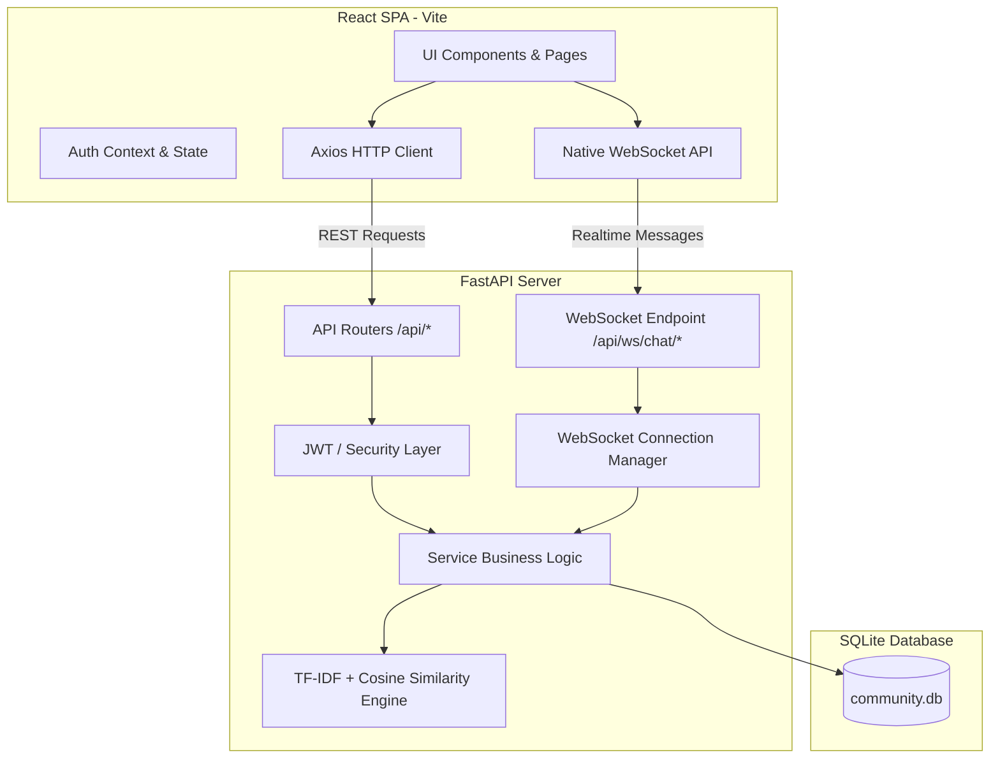

# Kindred — Community Connection Platform

> **"Find people who understand you."**  
> Nền tảng kết nối cộng đồng thông minh, giúp người dùng tìm thấy những người bạn đồng điệu và sẻ chia dựa trên khảo sát tâm lý, hoàn cảnh sống và sở thích cá nhân.

---

## 1. Project Description (Giới thiệu Dự án)

Kindred là một ứng dụng web kết nối cộng đồng (Community Connection Platform) được thiết kế cho MVP với triết lý: **Ấm áp, Hiện đại, Thân thiện và Tinh giản**. 

Thay vì dựa vào các thuật toán tương tác mạng xã hội độc hại hay lướt vô định, Kindred tập trung vào sự đồng cảm sâu sắc:
1. Người dùng trả lời một bộ câu hỏi khảo sát ngắn gọn về nhóm độ tuổi, hoàn cảnh hiện tại, mục tiêu, cảm xúc, sở thích và câu chuyện riêng.
2. Thuật toán xử lý ngôn ngữ tự nhiên truyền thống (**TF-IDF + Cosine Similarity**) phân tích biểu diễn văn bản và đề xuất những người có tần số tương đồng cao nhất.
3. Người dùng khám phá người phù hợp, xem profile công khai, gửi lời mời kết nối, nhận thông báo tức thì và trò chuyện thời gian thực qua **Realtime WebSocket Chat**.

---

## 2. Key Features (Tính năng Chính)

- **Authentication & Security**:
  - Đăng ký và đăng nhập bằng Email / Mật khẩu (băm bảo mật với `bcrypt`).
  - Đăng nhập một chạm bằng **Google OAuth 2.0** (Google Identity Services).
  - Phân quyền bảo mật qua **JSON Web Token (JWT)**, kiểm tra trạng thái hết hạn và phân quyền truy cập tài nguyên.
- **Onboarding Survey (Khảo sát Đồng điệu)**:
  - 6 bước khảo sát trực quan (Độ tuổi, Hoàn cảnh, Mục tiêu, Sở thích, Kiểu kết nối, Câu chuyện).
  - Lưu trữ và tự động đồng bộ sang Profile.
- **Matching Engine (Gợi ý Đồng điệu)**:
  - Sử dụng **Scikit-learn** với **TF-IDF Vectorizer** và **Cosine Similarity**.
  - Tính điểm phần trăm tương đồng (0–100%), tự động loại trừ chính bản thân, sắp xếp giảm dần.
  - Bóc tách sở thích chung (Common Interests) và tạo lý do tương đồng (Match Reasons).
- **Discover Page (Trang Khám phá)**:
  - Hiển thị danh thiếp người dùng tương đồng kèm % Match rực rỡ, tags chủ đề và lý do phù hợp.
  - Bộ lọc tìm kiếm nhanh theo độ tuổi, tình trạng, sở thích.
  - Modal xem chi tiết hồ sơ công khai (an toàn tuyệt đối, không lộ thông tin nhạy cảm).
- **Connection System (Hệ thống Kết nối)**:
  - Gửi lời mời kết nối, chặn kết nối chính mình và chặn gửi trùng lặp.
  - Quản lý 3 danh sách: Bạn bè của tôi, Lời mời đã nhận, Lời mời đã gửi.
  - Chấp nhận (Accept) hoặc Từ chối (Reject) với phân quyền kiểm soát nghiêm ngặt.
- **Realtime 1-1 Chat (Trò chuyện Thời gian thực)**:
  - Giao thức **FastAPI WebSocket** thuần kết hợp chuẩn **HTML5 WebSocket API** trong React (không dùng thư viện ngoài nặng nề).
  - Xác thực JWT query param và phân quyền thành viên trong hội thoại trước khi chấp nhận WebSocket.
  - Tự động fallback sang REST API nếu mạng có sự cố.
- **Notifications & Online Status (Thông báo & Trạng thái)**:
  - Chuông thông báo trực quan trên thanh điều hướng kèm badge số lượng chưa đọc.
  - Dropdown danh sách thông báo với icon phân loại, thời gian tương đối và điều hướng thông minh khi nhấp.
  - Trạng thái Online / Offline và thời gian hoạt động gần nhất (`last_seen`) cập nhật trực tiếp qua WebSocket connection manager.

---

## 3. Architecture (Kiến trúc Hệ thống)



---

## 4. Tech Stack (Công nghệ Cốt lõi)

| Tầng | Công nghệ | Chi tiết |
| :--- | :--- | :--- |
| **Frontend** | React 18, Vite | JavaScript, React Router DOM, Context API, CSS Tokens (Không Redux, không UI framework nặng) |
| **Backend** | Python 3.10+, FastAPI | Pydantic v2, SQLAlchemy 2.0 ORM, Uvicorn |
| **Matching / ML** | Scikit-learn | TF-IDF Vectorizer, Cosine Similarity (Không Deep Learning, không LLM) |
| **Database** | SQLite | `community.db` lưu trữ quan hệ chuẩn hóa |
| **Authentication**| JWT, Bcrypt, Google Auth | `pyjwt`, `bcrypt`, `google-auth` |
| **Realtime** | Native WebSocket | Giao thức WebSocket 1-1, tự động theo dõi online/offline |

---

## 5. Folder Structure (Cấu trúc Thư mục)

```
chat/
├── backend/
│   ├── app/
│   │   ├── core/           # Cấu hình JWT, bảo mật, hash mật khẩu
│   │   ├── db/             # Kết nối SQLAlchemy engine, Base, SessionLocal
│   │   ├── models/         # SQLAlchemy ORM models (User, Profile, Survey, Connection, Chat, Notification)
│   │   ├── schemas/        # Pydantic schemas request/response
│   │   ├── services/       # Business logic (User, Profile, Survey, Matching, Connection, Chat, Notification)
│   │   ├── routers/        # FastAPI endpoints (/api/auth, /api/users, /api/connections, /api/chat, etc.)
│   │   ├── websocket/      # ConnectionManager quản lý phòng chat và online status
│   │   └── main.py         # Entrypoint FastAPI, CORS middleware, auto-migration
│   ├── tests/              # Bộ test suites tự động cho backend
│   ├── .env                # Biến môi trường backend
│   ├── .env.example        # Mẫu biến môi trường
│   ├── requirements.txt    # Thư viện Python
│   └── community.db        # Cơ sở dữ liệu SQLite
├── frontend/
│   ├── src/
│   │   ├── components/     # Navbar, NotificationBell, ProtectedRoute, GoogleLoginButton
│   │   ├── contexts/       # AuthContext quản lý token và user state
│   │   ├── pages/          # Landing, Login, Register, Survey, Home, Discover, Communities, Connections, Messages, Profile
│   │   ├── services/       # Axios API client modules (api, chatService, connectionService, etc.)
│   │   ├── App.jsx         # Cấu hình React Router
│   │   ├── main.jsx        # Root render
│   │   └── index.css       # Design tokens, global CSS variables, animations
│   ├── package.json        # Cấu hình Node.js dependencies
│   └── vite.config.js      # Cấu hình Vite dev server & build
├── .gitignore              # Bộ lọc gitignore bảo vệ mã nguồn
├── README.md               # Tài liệu hướng dẫn dự án
└── MVP_STATUS.md           # Báo cáo trạng thái tính năng MVP
```

---

## 6. Installation & Environment Setup (Cài đặt)

### 6.1 Yêu cầu hệ thống
- **Python**: Phiên bản 3.10 trở lên
- **Node.js**: Phiên bản 18 trở lên (kèm `npm`)

### 6.2 Cài đặt Backend
```bash
cd backend

# 1. Tạo môi trường ảo (Virtual Environment)
python -m venv venv

# Kích hoạt môi trường ảo:
# Trên Windows:
venv\Scripts\activate
# Trên macOS / Linux:
source venv/bin/activate

# 2. Cài đặt các gói phụ thuộc
pip install -r requirements.txt

# 3. Tạo file cấu hình môi trường .env
copy .env.example .env   # Trên Windows
# cp .env.example .env   # Trên macOS / Linux
```

### 6.3 Cấu hình Biến môi trường (`backend/.env`)
```env
DATABASE_URL=sqlite:///./community.db
JWT_SECRET_KEY=your_secure_random_secret_key_here
JWT_ALGORITHM=HS256
ACCESS_TOKEN_EXPIRE_MINUTES=60
GOOGLE_CLIENT_ID=your_google_client_id_here.apps.googleusercontent.com
```

### 6.4 Cài đặt Frontend
```bash
cd ../frontend

# Cài đặt node modules
npm install
```

---

## 7. How to Run (Hướng dẫn Khởi chạy)

### 7.1 Chạy Backend
Tại thư mục `backend`:
```bash
# Đảm bảo virtualenv đã được kích hoạt
venv\Scripts\activate

# Khởi động máy chủ Uvicorn
uvicorn app.main:app --reload --port 8000
```
Backend API sẽ hoạt động tại: `http://localhost:8000`  
Interactive API Docs (Swagger UI): `http://localhost:8000/docs`

### 7.2 Chạy Frontend
Tại thư mục `frontend`:
```bash
npm run dev
```
Frontend Web App sẽ mở tại: `http://localhost:5173`

---

## 8. API Documentation (Tổng quan API Endpoints)

| Module | Method | Endpoint | Mô tả | Yêu cầu Auth |
| :--- | :--- | :--- | :--- | :--- |
| **Auth** | `POST` | `/api/auth/register` | Đăng ký tài khoản mới | Không |
| | `POST` | `/api/auth/login` | Đăng nhập bằng username/email + mật khẩu | Không |
| | `POST` | `/api/auth/google` | Đăng nhập bằng Google ID Token | Không |
| **Users** | `GET` | `/api/users/me` | Lấy thông tin tài khoản hiện tại | Bearer JWT |
| | `GET` | `/api/users/{id}/public` | Lấy thông tin công khai của người dùng | Bearer JWT |
| **Profile** | `GET` | `/api/profile/me` | Lấy hồ sơ cá nhân | Bearer JWT |
| | `PUT` | `/api/profile/me` | Cập nhật hồ sơ cá nhân | Bearer JWT |
| **Survey** | `POST` | `/api/survey` | Gửi/cập nhật câu trả lời khảo sát | Bearer JWT |
| | `GET` | `/api/survey/me` | Xem lại khảo sát cá nhân | Bearer JWT |
| **Matching** | `GET` | `/api/matches` | Gợi ý danh sách người phù hợp (TF-IDF) | Bearer JWT |
| **Connection** | `GET` | `/api/connections` | Danh sách bạn bè đã kết nối | Bearer JWT |
| | `GET` | `/api/connections/requests` | Danh sách lời mời gửi đến và gửi đi | Bearer JWT |
| | `POST` | `/api/connections/{user_id}` | Gửi lời mời kết nối tới user | Bearer JWT |
| | `PUT` | `/api/connections/{id}/accept` | Chấp nhận lời mời kết nối | Bearer JWT |
| | `PUT` | `/api/connections/{id}/reject` | Từ chối lời mời kết nối | Bearer JWT |
| **Chat** | `GET` | `/api/conversations` | Danh sách các cuộc trò chuyện | Bearer JWT |
| | `POST` | `/api/conversations/{user_id}` | Tạo/lấy hội thoại 1-1 với user | Bearer JWT |
| | `GET` | `/api/conversations/{id}/messages`| Lấy lịch sử tin nhắn trong phòng | Bearer JWT |
| | `POST` | `/api/conversations/{id}/messages`| Gửi tin nhắn qua REST (fallback) | Bearer JWT |
| | `WS` | `/api/ws/chat/{conv_id}?token=...`| Kết nối WebSocket chat realtime | Query Token |
| **Notifications**| `GET` | `/api/notifications` | Danh sách thông báo & số lượng chưa đọc | Bearer JWT |
| | `PUT` | `/api/notifications/{id}/read` | Đánh dấu một thông báo là đã đọc | Bearer JWT |
| | `PUT` | `/api/notifications/read-all` | Đánh dấu tất cả thông báo đã đọc | Bearer JWT |

---

## 9. Matching Algorithm (Thuật toán Ghép đôi)

Hệ thống sử dụng tổ hợp **TF-IDF + Cosine Similarity** trong `backend/app/services/matching_service.py`:
1. **Trích xuất thông tin**: Lấy toàn bộ các thuộc tính quan trọng từ `SurveyAnswer` (độ tuổi, tình trạng, cảm xúc gần đây, mục tiêu, chủ đề quan tâm, hoạt động rảnh rỗi, phong cách trò chuyện, câu chuyện tự thuật) kết hợp với `Profile.bio`.
2. **Biểu diễn văn bản (Text Representation)**: Ghép nối các trường thành một chuỗi văn bản chuẩn hóa bằng tiếng Việt có tiền tố ngữ nghĩa (ví dụ: `hoàn_cảnh_áp_lực_công_việc chủ_đề_công_nghệ ...`).
3. **TF-IDF Vectorization**: Sử dụng `TfidfVectorizer` của `scikit-learn` để chuyển đổi tập văn bản của tất cả người dùng thành ma trận vector đặc trưng số học, đánh trọng số cao cho các từ khóa độc đáo và hạ trọng số các từ xuất hiện đại trà.
4. **Cosine Similarity**: Tính góc cosine giữa vector của người dùng hiện tại và từng người dùng khác:
   $$\text{Similarity}(u_1, u_2) = \frac{\mathbf{v}_1 \cdot \mathbf{v}_2}{\|\mathbf{v}_1\| \|\mathbf{v}_2\|}$$
5. **Tính Match Score & Rule-based Explanation**: Chuyển đổi độ đo cosine sang thang điểm 0–100%, cộng thưởng điểm quy tắc (cùng độ tuổi, cùng hoàn cảnh sống, sở thích chung), sắp xếp giảm dần và loại trừ người dùng hiện tại.

---

## 10. WebSocket Realtime Architecture (Kiến trúc Realtime)

- **ConnectionManager**: Quản lý các socket theo từng phòng chat (`active_connections[conv_id][user_id]`) và theo dõi tổng thể số kết nối của người dùng (`user_sockets[user_id]`).
- **Xác thực an toàn**: Xác thực chữ ký JWT ngay từ bước bắt tay WebSocket qua Query Parameter. Kiểm tra quyền thành viên trong bảng `conversation_members` bằng SQLAlchemy trước khi gọi `websocket.accept()`. Đóng kết nối lập tức (`WS 1008 Policy Violation`) nếu vi phạm.
- **Tự động cập nhật Online Status**:
  - Khi user mở tab kết nối đầu tiên $\rightarrow$ DB cập nhật `is_online = True`, broadcast sự kiện `{ "type": "user_status", "user_id": ..., "is_online": true }`.
  - Khi user đóng kết nối cuối cùng $\rightarrow$ DB cập nhật `is_online = False`, `last_seen = now()`, broadcast sự kiện `{ "type": "user_status", "user_id": ..., "is_online": false, "last_seen": ... }`.

---

## 11. Testing & Quality Assurance (Kiểm thử)

### 11.1 Kiểm thử Backend Tự động
Tại thư mục `backend`, chạy toàn bộ bộ test kiểm chứng:
```bash
# 1. Chạy test suite toàn diện (Task 14)
venv\Scripts\python.exe tests\test_full_suite.py

# 2. Chạy test realtime websocket độc lập
venv\Scripts\python.exe tests\test_realtime_ws.py

# 3. Chạy test connections & permissions
venv\Scripts\python.exe tests\test_connections.py

# 4. Chạy test chat logic & idempotency
venv\Scripts\python.exe tests\test_chat_flow.py

# 5. Chạy test notifications & online status
venv\Scripts\python.exe tests\test_notifications_and_status.py
```
Tất cả các bộ test đều vượt qua 100% không có lỗi.

### 11.2 Kiểm thử Đóng gói Frontend
Tại thư mục `frontend`:
```bash
npm run build
```
Đóng gói hoàn tất thành công trong `dist/` sạch sẽ, không có cảnh báo hay lỗi cú pháp.

